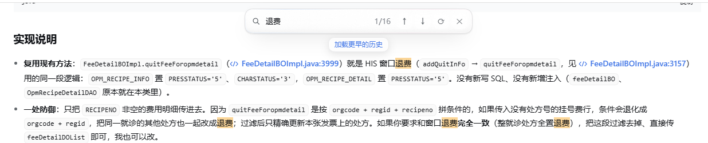
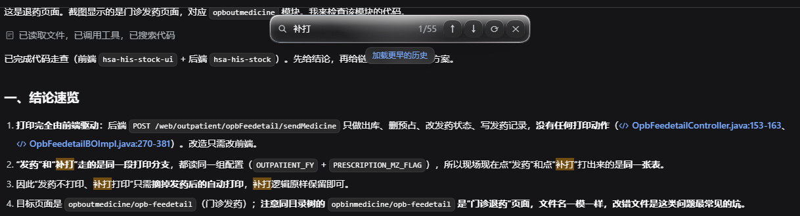

# dsh-chat-find

A **Ctrl+F find bar for the current conversation** in DeepSeek Harness. It matches
only your messages and the assistant's replies, highlights every hit, steps
between them, and loads earlier history when the match is older than the page the
client holds.

一个给 DeepSeek Harness 用的**对话内 Ctrl+F 查找条**：只匹配你的消息和助手回复，
全部高亮、逐条跳转，命中较早内容时可以就地加载更早的历史。

<p align="center">
  
</p>





## Install / 安装

The plugin installs straight from GitHub; there is no npm package and no build
step. 直接从 GitHub 安装，没有 npm 包，也不需要构建：

```sh
dsh plugin --profile desktop add git+https://github.com/LLinsanity/dsh-chat-find
```

Refresh the page once after installing (`Ctrl+R`).

已发布到 npm 的版本（如后续发布）也可以用短名字安装：
`dsh plugin --profile desktop add dsh-chat-find`。

## Usage / 用法

| Action | Key |
| --- | --- |
| Open the find bar | `Ctrl+F` (`Cmd+F` on macOS) |
| Next match | `Enter` or `↓` |
| Previous match | `Shift+Enter` or `↑` |
| Close | `Esc` or `✕` |
| Load older history and search again | **Load earlier history** in the bar's footer |

In the desktop app the chord is registered as the editable command
`conversation.find`, so it survives the native menu layer and can be rebound in
**Settings → Shortcuts**.

## What it searches / 搜索范围

- Your messages, assistant replies, steering notes, and answers to questions.
- Tool calls, tool output, and command output are **skipped on purpose**, so a
  query is not drowned by build logs.
- The bar only shows rows the Chat view has loaded. When the match is older, the
  footer offers **Load earlier history**, which uses the Chat view's own paging
  control and then searches again.

## How it differs from a DOM-wide find / 与页面查找的差别

- **CSS Custom Highlight API** instead of wrapping matches in `<mark>`: streaming
  replies do not invalidate the highlight, and editable areas are never touched.
- **Message-scoped search**: it reads Chat rows by their published
  `data-chat-flow-kind`, not the whole page, so the sidebar, composer, and tool
  cards never contribute matches.
- **Older history**: unloaded pages are pulled in on demand instead of being
  silently missing from the result count.
- **Themed glass UI**: colours come from the running theme tokens
  (`--dsw-alias-*`), light and dark both work; two CSS variables tune the pane
  (`--cf-blur`, `--cf-tint`).

## Liquid glass

The bar is drawn with what a browser can express of the iOS 26 glass vocabulary:
a real `backdrop-filter` blur and saturation of the content behind it, a
translucent fill from the theme's raised surface, a gradient specular ring, a
faint chromatic edge, a grain layer, and a highlight that follows the pointer.

| Property | Default | Effect |
| --- | --- | --- |
| `--cf-blur` | `26px` | Backdrop blur radius. |
| `--cf-tint` | `54%` | Opacity of the theme surface behind the blur. |

Refractive edge distortion of the content behind the glass is not possible with
`backdrop-filter`; the rim highlight and chromatic edge approximate that look.

## Known limitations / 已知限制

- Only the loaded page of the conversation is searchable; use **Load earlier
  history** first. Loading is capped at 20 pages per press.
- Matches are found inside a single text node: a phrase split by inline markup
  (for example a word broken across `code` and plain text) is not matched.
- The bar finds rows through the Chat view's `data-chat-flow-kind` and
  `[data-conversation-scroll]` attributes; a future DSH release that renames
  them needs a matching update here.
- Esc closes the bar, but focus returns to the page body rather than the
  composer.
- Desktop-only shortcut: in a browser the native Ctrl+F is left alone, which is
  the better tool there.

## Development

```sh
node test/wiring.test.cjs        # offline wiring checks (slots, command, locales)
node test/build-preview.cjs      # renders light/dark preview HTML from client.js
```

`client.js` is a single lazy factory registered with `window.__ModuleLoader__`;
`index.js` is an intentionally empty Host half.

## License

MIT
